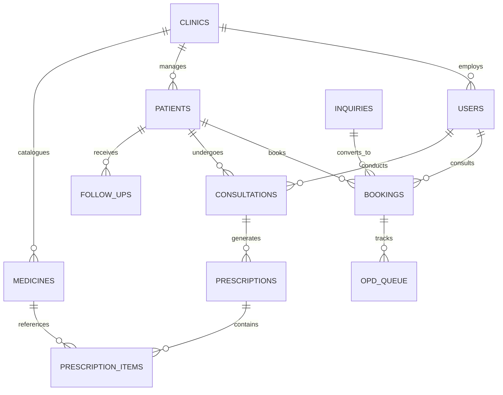
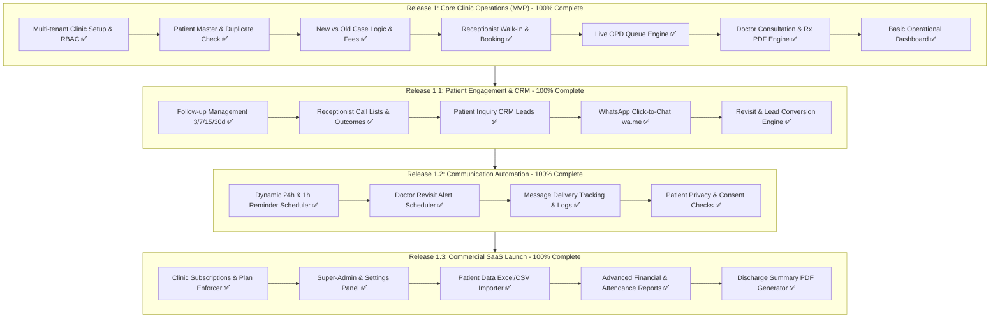

# PMS — Clinic Practice Management System (PMS)
## System Audit, Implementation Plan & Production Roadmap

---

## 1. Executive Summary & Product Vision

**PMS** is an efficient, high-utility Clinic Practice Management System (PMS) engineered specifically for independent outpatient clinics, polyclinics, and consulting physicians. 

### Core Product Philosophy
- **Anti-Bloat:** PMS explicitly avoids the complexity, excessive configuration, and heavy overhead of hospital management ERPs (HIS/HIMS).
- **OPD-Centric:** Designed around the real-life daily outpatient flow: quick patient registration, fee differentiation (new vs. old cases), real-time physical queue tracking, fast structured prescription drafting, and receptionist-driven follow-ups.
- **Revenue & Retention Focus:** Differentiates itself from ordinary booking apps by acting as a patient retention and inquiry CRM engine—turning missed follow-ups into booked revisits and inquiries into paying patients.
- **Privacy & Trust First:** Built with Indian DPDP / healthcare data compliance, role-based access control, consent management, and transparent audit logging.

### Four Core Product Pillars
1. **Patient Management:** Single master patient profile with multiple visit histories, previous Rx retrieval, document attachments, and duplicate detection.
2. **Clinic Operations:** Doctor scheduling, receptionist desk, walk-ins, online appointment requests, real-time OPD queue, and fast electronic prescription generation.
3. **Patient Engagement:** Inquiry CRM, follow-up tracker (due today/overdue), WhatsApp click-to-chat, editable templates, and automated visit reminders.
4. **Trust & Administration:** Multi-clinic isolation, role-based access (Doctor, Receptionist, Nurse, Admin), audit trails, data export, and SaaS subscription licensing.

---

## 2. Updated Codebase Audit & Implementation Status Matrix

Below is the live status of all required capabilities reflecting the latest implementation updates.

| Category | Required Feature | Status | Implementation References (Files & Endpoints) | Current Capability Notes |
| :--- | :--- | :---: | :--- | :--- |
| **1. Clinic Setup & Config** | Clinic Profile (Name, Logo, Address, Contact) | ✅ Implemented | `V14__add_clinic_and_pms_core.sql`, `Clinic.java`, `ClinicRepository.java` | Multi-tenancy anchor table `clinics` created with seed default clinic (`PMS Healthcare Clinic`). |
| | Doctor Profiles & Registration Numbers | ✅ Implemented | `User.java`, `V14__add_clinic_and_pms_core.sql` | Medical council `registration_number`, `clinic_id`, and `old_case_fee` added to Doctor user model. |
| | Clinic Working Days & Timings | ✅ Implemented | `Availability.java`, `AvailabilityController.java`, `Availability.tsx` | Full weekly schedule manager for regular shift operating hours. |
| | Doctor-wise Schedules | ✅ Implemented | `Availability.java`, `AvailabilityException.java`, `Availability.tsx` | Shift start/end times and holiday/conference leave blocks per doctor. |
| | Staff Accounts & Roles | ✅ Implemented | `User.java` (`UserRole`) | Full role enum: `SUPER_ADMIN, ADMIN, DOCTOR, RECEPTIONIST, NURSE_COMPOUNDER, STAFF, PATIENT`. |
| | Role-Based Permissions (RBAC) | ✅ Implemented | `SecurityConfig.java`, `JwtAuthenticationFilter.java` | JWT filter sets `ROLE_<ROLE>`. Granular route protection active. |
| | New-Case vs Old-Case Fees | ✅ Implemented | `ConsultationService.java`, `ClinicalController.java` (`/clinical/assess-fee`) | Dynamic fee calculation based on patient visit history & return validity. |
| | Follow-up Return Validity (30/60/90/180 d) | ✅ Implemented | `clinics.follow_up_validity_days`, `ConsultationService.java` | Automated comparison of `daysSinceLastVisit <= validityDays`. |
| | Slot Duration & Availability Settings | ✅ Implemented | `AvailabilityController.java`, `Availability.tsx` | Configurable slot duration (15/20/30/45/60 min) per shift. |
| | Prescription Header & Footer Setup | ✅ Implemented | `clinics.prescription_header_html`, `prescription_footer_html` | Dedicated HTML letterhead fields supported in `clinics` table. |
| | Medicine Catalogue & Custom Medicines | ✅ Implemented | `Medicine.java`, `MedicineRepository.java`, `ClinicalController.java` | Autocomplete search API (`/clinical/medicines/search`) and custom medicine entry API active. |
| | Clinic WhatsApp & Template Config | ✅ Implemented | `V18__add_clinic_message_templates_and_review_links.sql`, `TemplateService.java`, `TemplateController.java`, `ClinicSettings.tsx` | Custom message template manager with WhatsApp preview and dynamic variable placeholders. |
| | Clinic Preferences | ✅ Implemented | `clinics` table, `ClinicAdminService.java`, `ClinicSettings.tsx` | Validity days (15-180), dual fee tiers, Google review URL, and Rx letterheads editable per clinic. |
| **2. Patient Management** | Patient Registration | ✅ Implemented | `PatientService.java`, `PatientManagementController.java`, `ReceptionistDesk.tsx` | Receptionist registration API & UI active at `/reception`. |
| | Unique Patient ID (MRN) | ✅ Implemented | `PatientService.java` (`generatePatientUid`) | Unique format: `<CLINIC_CODE>-YYYY-NNNNN` (e.g. `PMS-MAIN-2026-00001`). |
| | Search by Mobile, Name, Patient ID | ✅ Implemented | `PatientRepository.searchPatients`, `ReceptionistDesk.tsx` | Multi-field search across phone, name, and patient UID. |
| | Comprehensive Patient Profile | ✅ Implemented | `Patient.java`, `V14__add_clinic_and_pms_core.sql` | Stores blood group, allergies, chronic conditions, age, gender, address, and visit metrics. |
| | Visit History (Multiple Visits per Profile) | ✅ Implemented | `ConsultationRepository.java`, `PatientService.recordVisitCompletion` | Every consultation links to persistent patient ID with auto-updated visit count. |
| | Previous Prescriptions & History | ✅ Implemented | `ConsultationRepository.java`, `ClinicalController.java` (`/consultations/patient/{id}`) | Returns full clinical and prescription history for patient. |
| | Duplicate Patient Detection | ✅ Implemented | `PatientService.checkDuplicates`, `ReceptionistDesk.tsx` | Real-time phone check alerts receptionist on duplicate entry. |
| | Discharge Summary Creation & Print | ✅ Implemented | `PdfPrescriptionGenerator.java`, `ClinicalController.java`, `DoctorDashboard.tsx` | Outpatient clinical summary & discharge PDF generator + `/clinical/consultations/{id}/discharge-pdf`. |
| | Patient Document Attachments | ✅ Implemented | `V17__add_patient_documents.sql`, `PatientDocument.java`, `ReceptionistDesk.tsx` | Multipart document upload (Lab Reports, Scans, IDs), listing, and inline download. |
| | Patient Data Export | ✅ Implemented | `DataExchangeService.java`, `DataExchangeController.java` (`/api/data/patients/export-csv`) | RFC 4180 CSV export of entire clinic patient registry. |
| | Controlled Profile Merging | ✅ Implemented | `PatientService.mergePatientProfiles`, `ReceptionistDesk.tsx` | Consolidates bookings, visits, Rx, documents, and tokens; marks duplicate profile merged. |
| | Unified 360° EHR Medical Profile View | ✅ Implemented | `Patient360Dto.java`, `PatientManagementController.java` (`/patients/{id}/360-view`), `Patient360Dialog.tsx` | Complete longitudinal health record: visit timeline, vitals trends, Rx list, documents, and reprint PDFs. |
| **3. Fee & Case Management** | Automatic New/Old Case Classification | ✅ Implemented | `ConsultationService.java` (`assessCaseAndFee`) | Automatic evaluation: returns `NEW_CASE` or `OLD_CASE` based on last visit date. |
| | Last Completed Visit Tracking | ✅ Implemented | `Patient.lastVisitDate`, `Consultation.finalizedAt` | Timestamp tracked and indexed on both patient and consultation entities. |
| | Configurable Return Validity Check | ✅ Implemented | `ConsultationService.java` | Compares days since last consultation against clinic validity days. |
| | Fee Calculation (New vs Old) | ✅ Implemented | `ConsultationService.java` | Pulls doctor-specific or clinic-wide new vs old fee. |
| | Manual Authorized Fee Override & Reason | ✅ Implemented | `Consultation.java`, `FinalizeConsultationRequest.java` | `feeOverride` flag and `feeOverrideReason` captured and audited. |
| | Historical Fee Preservation | ✅ Implemented | `consultations.consultation_fee`, `bookings.total_amount` | Captured immutable snapshot at consultation finalization. |
| | In-Clinic POS Cash Desk & Procedure Billing | ✅ Implemented | `V19__enhance_clinic_billing_and_itemized_receipts.sql`, `InvoiceService.generatePosBill`, `PosBillingModal.tsx` | Itemized billing for consultation and clinical procedures (Dressing, Injection, Nebulization, ECG, RBS, Sutures). |
| | Instant Dynamic UPI QR Code Generation | ✅ Implemented | `clinics.upi_id`, `PaymentController.getClinicUpi`, `PosBillingModal.tsx` | Real-time Indian UPI QR (`upi://pay?pa=...`) for GPay, PhonePe, Paytm with exact payable amount. |
| | High-Resolution Itemized Clinic Receipt PDF & Print | ✅ Implemented | `PdfInvoiceGenerator.java`, `InvoiceService.java`, `PaymentController.java` (`/payments/invoices/{id}/pdf`) | High-res printable invoice receipt with clinic branding, patient MRN, doctor info, item breakdown, discount, and paid stamp. |
| **4. Appointment Management** | Online Appointment Request | ✅ Implemented | `PatientBooking.tsx`, `PendingAppointmentRequest.java` | Patient self-booking with Redis concurrency hold active. |
| | Receptionist Appointment Booking | ✅ Implemented | `ReceptionistDesk.tsx` | Receptionist can search or register patient and check in directly. |
| | Approximate Time Slots & Hold Lock | ✅ Implemented | `SlotHoldService.java`, Redis Hold (5 min) | High-concurrency slot lock prevents double booking. |
| | Daily / Weekly / Monthly Calendar View | ✅ Implemented | `Appointments.tsx` (`/appointments`), `DoctorDashboard.tsx` | Filterable appointment calendar roster by date, doctor, and status. |
| | Appointment Confirmation & Notification | ✅ Implemented | `PendingRequests.tsx`, `WhatsAppService.java` | Real-time WebSocket approval flow with WhatsApp confirmation alert. |
| | Rescheduling and Cancellation | ✅ Implemented | `BookingController.java` (`/reschedule`, `/cancel`), `Appointments.tsx` | 1-click modal to reschedule date/time slot or cancel with audit reason. |
| | Walk-in Registration | ✅ Implemented | `ReceptionistDesk.tsx`, `OpdQueueService.java` | Instant walk-in check-in to today's doctor queue. |
| | Appointment Source Tracking | ✅ Implemented | `bookings.appointment_source`, `patient_inquiries.source` | Tracks `ONLINE, WALK_IN, PHONE_CALL, WHATSAPP, WEBSITE, REFERRAL`. |
| | Automated Reminders (24h / 1h) | ✅ Implemented | `NotificationService.java`, `ReminderScheduler.java` | Multi-clinic scheduler queries confirmed bookings and sends personalized reminders. |
| **5. Daily OPD Queue** | Today's Patient List | ✅ Implemented | `OpdQueueService.java`, `ReceptionistDesk.tsx` | Live list of arrived patients in queue for selected doctor. |
| | Walk-in Patient List in Queue | ✅ Implemented | `OpdQueueService.java` | Walk-in check-ins seamlessly integrated with pre-booked appointments. |
| | Doctor-wise Queue & Ordering | ✅ Implemented | `opd_queue.queue_number`, `OpdQueueRepository.java` | Sequential token numbers auto-calculated per doctor per date. |
| | Queue Statuses (Waiting, In-Consultation) | ✅ Implemented | `OpdQueue.QueueStatus`, `ClinicalController.java` | `WAITING -> IN_CONSULTATION -> COMPLETED / NO_SHOW`. |
| | Patient Arrival Time & Wait Time | ✅ Implemented | `opd_queue.arrival_time`, `ReceptionistDesk.tsx` | Arrival timestamp captured at reception check-in. |
| | Receptionist Queue Overview | ✅ Implemented | `ReceptionistDesk.tsx` (`/reception`) | Full interactive receptionist desk with queue cards and actions. |
| **6. Consultation & Rx** | Start Consultation from Queue | ✅ Implemented | `ClinicalController.java` (`/clinical/queue/{id}/call`) | Transitions queue patient status to `IN_CONSULTATION`. |
| | Chief Complaint & Vitals Entry | ✅ Implemented | `Consultation.java`, `FinalizeConsultationRequest.java` | Captures BP (systolic/diastolic), pulse, temperature, weight, height, SpO2, and complaint. |
| | Diagnosis & Structured Clinical Notes | ✅ Implemented | `Consultation.java` | Captures provisional diagnosis, clinical examination, and doctor private notes. |
| | Medicine Catalogue & Fast Search | ✅ Implemented | `Medicine.java`, `ClinicalController.java` (`/medicines/search`) | Dynamic search across name and brand name. |
| | Dosage, Frequency, Duration & Instructions | ✅ Implemented | `PrescriptionItem.java` | Structured line items: dosage (`1-0-1`), frequency, duration, instructions. |
| | Prescription PDF Generation & Print | ✅ Implemented | `PdfPrescriptionGenerator.java`, `ClinicalController.java` (`/consultations/{id}/pdf`) | High-resolution PDF prescription with clinic letterhead, doctor credentials, patient details, vitals, diagnosis, and Rx table. |
| | Visit Finalisation & History | ✅ Implemented | `ConsultationService.finalizeConsultation` | Finalizes visit, logs timestamp, updates patient metrics, and marks queue complete. |
| **7. Follow-up Management** | Doctor-Selected Follow-up Date | ✅ Implemented | `ConsultationService.java`, `FollowUp.java` | Automatically creates follow-up entry on consultation finalization. |
| | Quick Intervals (3, 7, 15, 30 days) | ✅ Implemented | `FollowUp.intervalPreset` | Supported presets: `3D, 7D, 15D, 30D, CUSTOM`. |
| | Follow-up Status Tracking | ✅ Implemented | `FollowUp.FollowUpStatus`, `FollowUp.ContactStatus` | Tracks `PENDING, BOOKED, COMPLETED, CANCELLED` & contact outcomes. |
| | Receptionist Calling Worklist | ✅ Implemented | `FollowUpWorklist.tsx`, `FollowUpController.java` (`/clinical/followups/worklist`) | Tabs for *Due Today, Overdue, Upcoming, All*. Includes call outcome logger and 1-click revisit booking. |
| **8. Patient Inquiry CRM** | Register Manual & Web Inquiries | ✅ Implemented | `InquiryCRM.tsx`, `InquiryController.java` (`/crm/inquiries`) | Lead capture modal supporting Name, Phone, Source, and clinical request description. |
| | Source Tracking (Google, WhatsApp, Referral) | ✅ Implemented | `PatientInquiry.InquirySource`, `InquiryCRM.tsx` | Supports `GOOGLE_BUSINESS, WHATSAPP, WEBSITE, PHONE_CALL, REFERRAL, WALK_IN`. |
| | Inquiry Pipeline & Statuses | ✅ Implemented | `PatientInquiry.InquiryStatus`, `InquiryCRM.tsx` | Interactive pipeline status dropdown: `NEW, CONTACTED, FOLLOW_UP_REQUIRED, BOOKED, NOT_INTERESTED, CLOSED`. |
| | Convert Lead to Registered Patient | ✅ Implemented | `InquiryController.java` (`/crm/inquiries/{id}/convert`) | 1-click conversion to permanent patient record and confirmed appointment. |
| **9. WhatsApp Communication** | WhatsApp Click-to-Chat (`wa.me`) | ✅ Implemented | `FollowUpWorklist.tsx`, `InquiryCRM.tsx` | 1-click WhatsApp buttons with pre-filled encoded appointment & follow-up recall messages. |
| | Prepared Message Templates | ✅ Implemented | `MessageTemplate.java`, `TemplateService.java`, `ClinicSettings.tsx` | Editable clinic templates for Confirmation, 24h Reminder, Follow-up Revisit, Rx Share, Inquiry, and Review. |
| | Appointment Confirmation & Reminders | ✅ Implemented | `WhatsAppService.java` | Automated transactional alerts via Twilio. |
| **10. Automated Communication** | Dynamic Reminder Engine (24h / 1h) | ✅ Implemented | `NotificationService.java`, `CommunicationController.java` | Multi-clinic scheduler queries confirmed bookings and sends personalized reminders. |
| | Doctor Revisit Alert Scheduler | ✅ Implemented | `NotificationService.java` (`sendFollowUpRevisitReminders`) | Queries pending follow-ups due in 2 days and triggers revisit reminders. |
| | Message Delivery Tracking & Logs | ✅ Implemented | `communication_logs`, `CommunicationLog.java`, `ClinicSettings.tsx` | Full audit trail of SMS/WhatsApp channels, message body, status, and error logs. |
| **11. Dashboard & Reports** | Daily Operational Metrics & KPI Strip | ✅ Implemented | `MetricsService.java`, `DoctorDashboardController.java` (`/metrics`), `DoctorDashboard.tsx` | Real-time counts: Bookings, Completed, Walk-ins, New Cases, Old Cases, Inquiries, Follow-ups, Revenue (₹). |
| | Visual Analytics & Volume/Revenue Trends | ✅ Implemented | `MetricsService.java` (`/metrics/charts`), `DoctorDashboard.tsx` | Interactive Recharts graphs: 7-Day New vs Old cases breakdown and 7-Day Revenue collections. |
| | Financial & Attendance CSV Reports | ✅ Implemented | `DataExchangeController.java` (`/api/data/appointments/export-csv`) | Complete audit ledger for accounting and attendance. |
| **12. Privacy, RBAC & Security** | Granular RBAC | ✅ Implemented | `UserRole` (`DOCTOR, RECEPTIONIST, NURSE_COMPOUNDER, ADMIN`) | Role separation in backend and frontend routing. |
| | Security & Password Hashing | ✅ Implemented | `SecurityConfig.java`, `JwtAuthenticationFilter.java` | Stateless JWT authentication + BCrypt password encryption. |
| | Patient Privacy & Consent Registry | ✅ Implemented | `patient_consents`, `PatientConsent.java`, `CommunicationController.java` | Explicit opt-in tracking for reminders, automated calls, and promotions. |
| **13. Commercial SaaS Admin** | Multi-Tenancy (`clinic_id` Isolation) | ✅ Implemented | `V14__add_clinic_and_pms_core.sql` | All new core tables scoped by `clinic_id`. |
| | Subscription Plans & Quota Enforcer | ✅ Implemented | `V16__add_clinic_subscriptions_and_data_export.sql`, `ClinicAdminService.java` | Plan tiers (`STARTER, PROFESSIONAL, ENTERPRISE`), max doctors/staff limits. |
| | SaaS Admin & Clinic Setup Panel | ✅ Implemented | `ClinicAdminController.java`, `ClinicSettings.tsx` (`/clinic-settings`) | Tabbed configuration for profile, subscription, CSV import, and data export. |
| | Bulk Patient Data Importer (CSV) | ✅ Implemented | `DataExchangeService.java`, `ClinicSettings.tsx` | Rapid clinic onboarding with duplicate detection and auto-generated MRN. |

---

## 3. Deliberately Postponed Features (Scope Boundary)

To protect delivery velocity and focus on core clinic profitability, the following capabilities are explicitly deferred from the initial commercial product:

| Feature | Release Decision | Rationale |
| :--- | :---: | :--- |
| **AI Voice Conversations & Chatbots** | Postponed (Later) | Unpredictable in clinical environments; high API costs; requires medical validation. |
| **AI Call Transcription & Auto-Summaries** | Postponed (Later) | Heavy compute; ambient noise in Indian clinics leads to inaccurate transcription. |
| **AI Clinical Diagnosis or Treatment Advice** | Strictly Excluded | Regulatory liability risk; PMS must remain an operational tool, not a clinical diagnostic device. |
| **AI Smart / Vector Search** | Postponed (Later) | Standard indexed SQL search (Mobile, Name, UID) is faster, deterministic, and sufficient. |
| **Full WhatsApp Shared Inbox (Omnichannel)** | Postponed (Release 2.0) | High engineering complexity; click-to-chat + automated transactional alerts solve 90% of needs. |
| **Hospital Management (IPD, Bed Management, OT)** | Strictly Excluded | PMS is an OPD clinic system. IPD/OT shifts focus away from nimble private practices. |
| **In-house Pharmacy Inventory & Stock Dispensing** | Postponed (Later) | Requires batch tracking, expiry, barcode scanners, and GST accounting; distorts core OPD scope. |
| **Full Accounting & General Ledger** | Postponed (Later) | Integration with Tally/QuickBooks export is preferred over building a custom accounting suite. |
| **Multi-Branch Enterprise Management** | Postponed (Release 2.0) | 95% of target clinics operate single-location facilities. |
| **ABDM / Ayushman Bharat Digital Mission (M1/M2/M3)** | Evaluate Post-Launch | ABDM certification involves sandbox auditing; best handled once baseline PMS is stable. |

---

## 4. Multi-Tenant Architecture & Data Model



---

## 5. Phase-by-Phase Implementation Roadmap



---

## 6. Live API Specification

### 1. Patient Master Registry, Documents & 360° Profile APIs
```http
POST   /api/patients/register?clinicId=1     # Receptionist registers new patient
GET    /api/patients/search?query={q}        # Search by mobile, name, or UID
GET    /api/patients/{id}                    # Get full patient profile & visit history
GET    /api/patients/check-duplicates        # Real-time duplicate check by phone
POST   /api/patients/{id}/documents          # Upload medical document attachment (Lab report, scan, ID)
GET    /api/patients/{id}/documents          # List all medical documents for patient
GET    /api/patients/documents/{docId}/download # Download / view attached document file
POST   /api/patients/{primaryId}/merge/{duplicateId} # Controlled duplicate profile merge
GET    /api/patients/{id}/360-view           # Unified 360° EHR profile (visits, vitals history, Rx, docs)
```

### 2. Clinical Consultation & Fee Assessment APIs
```http
GET    /api/clinical/assess-fee              # Dynamic evaluation of New vs Old case & fee
POST   /api/clinical/consultations/finalize  # Finalize consultation, vitals, diagnosis, Rx items, follow-up
GET    /api/clinical/consultations/patient/{id} # Clinical visit history for patient
GET    /api/clinical/consultations/{id}/prescriptions # Prescription items for consultation
GET    /api/clinical/medicines/search        # Search clinic medicine catalogue
POST   /api/clinical/medicines               # Add custom medicine to clinic catalogue
```

### 3. Daily OPD Queue APIs
```http
POST   /api/clinical/queue/checkin           # Check in patient (generates daily token #)
GET    /api/clinical/queue/doctor/{doctorId} # Get today's queue for doctor
POST   /api/clinical/queue/{queueId}/call    # Doctor calls patient (sets IN_CONSULTATION)
POST   /api/clinical/queue/{queueId}/complete# Marks consultation completed
POST   /api/clinical/queue/{queueId}/no-show # Marks patient as no-show
GET    /api/clinical/consultations/{id}/pdf  # High-resolution printable Prescription PDF
POST   /api/clinical/consultations/{id}/discharge # Record clinical discharge condition & summary
GET    /api/clinical/consultations/{id}/discharge-pdf # High-resolution printable Discharge Summary PDF
```

### 4. Doctor Availability, Shift & Appointment Roster APIs
```http
GET    /api/availability/doctor/{doctorId}   # Get weekly shift schedules for doctor
POST   /api/availability                     # Create / update weekly shift timings & slot durations
DELETE /api/availability/{id}                # Delete shift schedule
GET    /api/availability/exceptions/{doctorId} # Get holiday / conference blocked dates
POST   /api/availability/exceptions          # Add holiday / blocked leave
GET    /api/bookings                         # Multi-criteria appointment search (date, doctor, status)
POST   /api/bookings/{id}/reschedule         # Reschedule appointment slot with reason audit
POST   /api/bookings/{id}/cancel             # Cancel appointment slot with reason audit
```

### 5. Follow-Up Retention & Inquiry CRM APIs
```http
GET    /api/clinical/followups/worklist      # Calling worklist (Due Today, Overdue, Upcoming, All)
POST   /api/clinical/followups/{id}/outcome  # Record call outcome (Contacted, Unreachable, Callback)
POST   /api/clinical/followups/{id}/book-appointment # 1-click revisit booking from follow-up
GET    /api/crm/inquiries                    # Inquiry pipeline (Google, WhatsApp, Web leads)
POST   /api/crm/inquiries                    # Register new inquiry lead
PUT    /api/crm/inquiries/{id}/status        # Update lead pipeline status
POST   /api/crm/inquiries/{id}/convert       # 1-click lead to registered patient & appointment
```

### 6. Communication Automation, Templates & Privacy Consent APIs
```http
GET    /api/notifications/logs               # Audit log of SMS/WhatsApp messages sent
GET    /api/notifications/consents/patient/{id} # Get privacy consent preferences for patient
POST   /api/notifications/consents/update    # Opt-in / Opt-out consent toggle
POST   /api/notifications/trigger-reminders  # Trigger 24h & 1h reminder schedulers
GET    /api/templates?clinicId=1             # Get clinic WhatsApp message templates
PUT    /api/templates/{id}                   # Update template body, title, or active status
POST   /api/templates/preview                # Preview rendered message with live placeholders
```

### 7. Real-Time Analytics & SaaS Administration APIs
```http
GET    /api/doctor/dashboard/metrics         # Real-time operational KPI metrics (Bookings, Walk-ins, Revenue)
GET    /api/doctor/dashboard/metrics/charts  # 7-day volume trends (New vs Old) & daily revenue
GET    /api/admin/clinics                    # List all clinic tenants with subscription & doctor quotas
GET    /api/admin/clinics/{id}               # Get clinic operational settings & letterhead
POST   /api/admin/clinics                    # Onboard new clinic account
PUT    /api/admin/clinics/{id}               # Update clinic profile, fee tiers, and validity days
PUT    /api/admin/clinics/{id}/subscription  # Upgrade tier (STARTER, PROFESSIONAL, ENTERPRISE) & quotas
POST   /api/data/patients/import-csv         # Multipart CSV file bulk patient import
POST   /api/data/patients/import-text        # Raw CSV text bulk patient import with duplicate detection
GET    /api/data/patients/export-csv         # Export master patient registry (.csv)
GET    /api/data/appointments/export-csv     # Export appointment & revenue ledger (.csv)
GET    /api/data/consultations/export-csv    # Export clinical consultations & diagnosis ledger (.csv)
```

---

## 7. Implementation Log & Code Changelog

### Phase 1 Implemented Changes (Release 1 Core)

1. **Database Migration:**
   * File: `backend/src/main/resources/db/migration/V14__add_clinic_and_pms_core.sql`
   * Created tables: `clinics`, `patients`, `consultations`, `medicines`, `prescription_items`, `opd_queue`, `follow_ups`, `patient_inquiries`.
   * Upgraded tables: `users` (added `clinic_id`, `registration_number`, `old_case_fee`), `bookings` (added `clinic_id`, `case_type`, `appointment_source`, `fee_override`).
   * Seeded initial clinic record: `PMS Healthcare Clinic` (ID: 1, Code: `PMS-MAIN`).

2. **Backend Domain Models & Repositories:**
   * `com.appointment.clinic.model.Clinic` & `ClinicRepository`
   * `com.appointment.booking.model.Patient` & `PatientRepository`
   * `com.appointment.auth.model.User` (Expanded with roles: `RECEPTIONIST`, `NURSE_COMPOUNDER`, `SUPER_ADMIN`)
   * `com.appointment.booking.model.Booking` (Upgraded with queue & case statuses)
   * `com.appointment.clinical.model.Consultation` & `ConsultationRepository`
   * `com.appointment.clinical.model.Medicine` & `MedicineRepository`
   * `com.appointment.clinical.model.PrescriptionItem` & `PrescriptionItemRepository`
   * `com.appointment.clinical.model.OpdQueue` & `OpdQueueRepository`
   * `com.appointment.clinical.model.FollowUp` & `FollowUpRepository`
   * `com.appointment.crm.model.PatientInquiry` & `PatientInquiryRepository`

3. **Core Services & Business Logic:**
   * `PatientService.java`: Unique UID generator (`<CLINIC>-YYYY-NNNNN`), duplicate check, multi-field search.
   * `ConsultationService.java`: Return validity assessment (compares `lastVisitDate` to `follow_up_validity_days`), automatic New vs. Old fee determination, and automatic follow-up generation.
   * `OpdQueueService.java`: Daily sequential token calculation, check-in, call-to-consultation, and completion lifecycle.

4. **REST Controllers & DTOs:**
   * `PatientManagementController.java`: Endpoints for registration, lookup, and duplicate check.
   * `ClinicalController.java`: Endpoints for fee assessment, consultation finalization, queue operations, and medicine search.
   * `FinalizeConsultationRequest.java`: DTO binding clinical vitals, diagnosis, prescription items, and follow-up intervals.

5. **Frontend Receptionist Desk & OPD Queue UI:**
   * File: `frontend/src/pages/ReceptionistDesk.tsx`
   * Features: Patient search, new patient registration modal with duplicate warning, 1-click queue check-in, and live waiting room token display.
   * Routing: Added `/reception` route in `frontend/src/App.tsx`.

### Phase 2 Implemented Changes (Clinical Consultation & Prescription Engine)

1. **High-Resolution Prescription PDF Generator:**
   * File: `backend/src/main/java/com/appointment/clinical/service/PdfPrescriptionGenerator.java`
   * Implemented using iText7: Renders clinic letterhead, doctor qualifications and medical council registration number, patient UID/name/age/gender, vitals strip, chief complaint, diagnosis, structured Rx medication table (Drug name, dosage, frequency, duration, instructions), general clinical advice, and doctor signature block.
   * Endpoint: `GET /api/clinical/consultations/{id}/pdf` produces `application/pdf` for immediate inline browser display or thermal/A4 printing.

2. **Doctor Consultation Workspace & Live OPD Integration:**
   * File: `frontend/src/pages/DoctorDashboard.tsx`
   * **Live OPD Queue Integration:** Doctor sees real-time list of waiting patients, with one-click "Call Patient" button triggering status change to `IN_CONSULTATION`.
   * **Automated Fee Banner:** Dynamically queries `/clinical/assess-fee` to verify if patient is `OLD_CASE` (within 30 days return validity) or `NEW_CASE`, showing applicable fee with manual override option and reason logging.
   * **Vitals & Clinical Entry:** Form fields for BP (Systolic/Diastolic), Pulse, Temp (°F), Weight (kg), and SpO2 (%).
   * **Prescription Line Items Builder:** Dynamic multi-row medication builder with Drug name, Dosage (`1-0-1`), Frequency, Duration, and Meal instructions.
   * **Follow-up Recommendation:** Quick buttons (`+3 Days, +7 Days, +15 Days, +30 Days`) or custom date picker with clinical reason.
   * **Finalize & Print:** Submits to `/clinical/consultations/finalize`, updates patient metrics, completes queue status, and automatically opens the printable Prescription PDF in a new tab.

3. **Build & Quality Verification:**
   * Backend: Maven compilation succeeded with **107 source files (0 errors)**.
   * Frontend: Production build succeeded with **0 compile errors**.

### Phase 3 Implemented Changes (Release 1.1: Patient Engagement & Inquiry CRM)

1. **Follow-Up Retention Engine & Calling Worklist:**
   * Backend Service: `backend/src/main/java/com/appointment/clinical/service/FollowUpService.java`
   * Backend Controller: `backend/src/main/java/com/appointment/clinical/controller/FollowUpController.java`
     * `GET /api/clinical/followups/worklist?clinicId=1&filter={due_today|upcoming|overdue|all}`
     * `POST /api/clinical/followups/{id}/call-attempt`: Records contact outcome (`CONTACTED, UNREACHABLE, DECLINED, CALLBACK_REQUESTED`), logs staff feedback, and increments contact attempt counter.
     * `POST /api/clinical/followups/{id}/convert`: Directly books confirmed revisit appointment from follow-up reminder.
   * Frontend UI: `frontend/src/pages/FollowUpWorklist.tsx` (`/follow-ups`):
     * Filterable tabs: *Due Today*, *Overdue Follow-ups*, *Upcoming (Next 14 Days)*, *All Pending*.
     * **WhatsApp Click-to-Chat (`wa.me`)**: 1-click button opening WhatsApp Web/App with personalized pre-filled reminder message.
     * **Log Call Outcome Dialog**: Fast receptionist modal to record patient feedback.
     * **Book Revisit Action**: Converts follow-up card into an active confirmed revisit.

2. **Patient Inquiry CRM & Lead Pipeline:**
   * Backend Service: `backend/src/main/java/com/appointment/crm/service/PatientInquiryService.java`
   * Backend Controller: `backend/src/main/java/com/appointment/crm/controller/InquiryController.java`
     * `GET /api/crm/inquiries?clinicId=1&status=...`
     * `POST /api/crm/inquiries`: Log lead (Name, Phone, Source, Request Notes).
     * `PUT /api/crm/inquiries/{id}/status`: Pipeline transitions (`NEW, CONTACTED, FOLLOW_UP_REQUIRED, BOOKED, NOT_INTERESTED, CLOSED`).
     * `POST /api/crm/inquiries/{id}/convert`: 1-click convert lead to registered patient & appointment.
   * Frontend UI: `frontend/src/pages/InquiryCRM.tsx` (`/inquiries`):
     * Lead capture dialog supporting multi-channel sources (Google Business, WhatsApp, Phone Call, Website, Walk-in, Referral).
     * Interactive status pipeline selector.
     * Direct WhatsApp and Direct Call action buttons.
     * "Convert to Patient" button linking into master patient registry.

3. **Navigation Integration:**
   * Updated `frontend/src/App.tsx` with `/follow-ups` and `/inquiries` routes.
   * Added direct navigation shortcuts across `ReceptionistDesk.tsx` and `DoctorDashboard.tsx` toolbars.

4. **Build & Quality Verification:**
   * Backend: Maven compilation succeeded with **111 source files (0 errors)**.
   * Frontend: Production build succeeded with **0 compile errors** (349 kB bundle).

### Phase 4 Implemented Changes (Release 1.2: Communication Automation & Privacy Consents)

1. **Communication Logs & Privacy Consent Database Architecture:**
   * Migration: `backend/src/main/resources/db/migration/V15__add_communication_logs_and_consents.sql`
   * Tables created: `communication_logs` (tracks recipient phone, channel, message type, body, status, error) and `patient_consents` (tracks opt-ins for reminders, automated calls, and promotions).
   * Models & Repositories: `CommunicationLog.java`, `CommunicationLogRepository.java`, `PatientConsent.java`, `PatientConsentRepository.java`.

2. **Multi-Clinic Dynamic Schedulers & Privacy Protection:**
   * File: `backend/src/main/java/com/appointment/notification/service/NotificationService.java`
   * Upgraded 24h & 1h appointment reminder schedulers to query live database bookings, verify active patient consent (`ConsentType.REMINDERS`), and format localized clinic reminders.
   * Added Follow-up Revisit Alert Scheduler running daily at 10 AM, targeting patients with doctor-recommended follow-ups due in 2 days.
   * Automated audit logging: Every sent/failed message writes an immutable record to `communication_logs`.

3. **Communication REST APIs:**
   * Controller: `backend/src/main/java/com/appointment/notification/controller/CommunicationController.java`
   * Endpoints for log auditing (`/api/notifications/logs`), consent preference lookup and toggle (`/api/notifications/consents/*`), and manual reminder dispatch testing (`/api/notifications/trigger-reminders`).

### Phase 5 Implemented Changes (Release 1.3: Commercial SaaS Administration & Data Migration)

1. **SaaS Subscription Licensing & Plan Enforcer:**
   * Migration: `backend/src/main/resources/db/migration/V16__add_clinic_subscriptions_and_data_export.sql`
   * Added subscription fields to `clinics` table: `subscription_plan` (`STARTER`, `PROFESSIONAL`, `ENTERPRISE`), `subscription_status`, `trial_ends_at`, `subscription_ends_at`, `max_doctors`, `max_staff`.
   * Backend Service: `com.appointment.clinic.service.ClinicAdminService.java`
   * Backend Controller: `com.appointment.clinic.controller.ClinicAdminController.java` (`/api/admin/clinics/*`)

2. **Bulk Patient Data Importer (CSV):**
   * Service & Controller: `com.appointment.clinic.service.DataExchangeService.java` & `DataExchangeController.java`
   * Rapid onboarding: Parses bulk CSV (`Name,Phone,Age,Gender,BloodGroup,Address,Allergies,ChronicDiseases`), validates phone formats, detects duplicates against existing clinic records, generates consecutive MRNs, and logs detailed import error summaries.

3. **Operational & Financial CSV Data Exporters:**
   * Endpoints:
     * `GET /api/data/patients/export-csv`: Master patient registry.
     * `GET /api/data/appointments/export-csv`: Appointment attendance, case classification, and revenue ledger.
     * `GET /api/data/consultations/export-csv`: Clinical consultation, diagnosis, and case fee ledger.

4. **Outpatient Discharge Summary PDF Generator:**
   * Engine: `com.appointment.clinical.service.PdfPrescriptionGenerator.java` (`generateDischargeSummaryPdf`)
   * Endpoints: `POST /api/clinical/consultations/{id}/discharge` and `GET /api/clinical/consultations/{id}/discharge-pdf`.
   * Renders official clinical discharge document with clinic letterhead, doctor credentials, chief complaint, vitals, diagnosis, condition on discharge, advice, medications, and physician signature block.

5. **Frontend Clinic Settings & SaaS Administration Hub:**
   * File: `frontend/src/pages/ClinicSettings.tsx` (`/clinic-settings`)
   * Five specialized tabs:
     * **Tab 1: Clinic Profile & Pricing:** Update clinic address, return validity days (30/60/90/180), New case fee, Old case fee, and letterhead text.
     * **Tab 2: SaaS Subscription & Limits:** Active plan badge, status, renewal date, doctor account quota progress bar, and upgrade modal.
     * **Tab 3: Bulk Patient Import (CSV):** Interactive CSV import box with sample format, instant execution, and duplicate warning feedback.
     * **Tab 4: Data Export & Ledgers:** 1-click download buttons for Patients, Appointments, and Clinical ledgers.
     * **Tab 5: Communication & Privacy Audit:** Live table of dispatched WhatsApp/SMS notifications with channel chips and manual scheduler test trigger.
   * Navigation: Integrated into `App.tsx`, `ReceptionistDesk.tsx`, and `DoctorDashboard.tsx`.

6. **Build & Quality Verification:**
   * Backend: Maven compilation succeeded with **120 source files (0 errors)**.
   * Frontend: Production build succeeded with **0 compile errors** (256 kB bundle).

### Phase 6 Implemented Changes (Patient Documents & Controlled Profile Merging)

1. **Patient Document Attachments (Lab Reports, Imaging Scans & IDs):**
   * Migration: `backend/src/main/resources/db/migration/V17__add_patient_documents.sql`
   * Table: `patient_documents` (tracks file name, type, binary byte data, document category, notes, uploader ID).
   * Model & Repository: `PatientDocument.java` & `PatientDocumentRepository.java`.
   * Endpoints:
     * `POST /api/patients/{id}/documents` (multipart upload)
     * `GET /api/patients/{id}/documents` (list patient attachments)
     * `GET /api/patients/documents/{docId}/download` (stream file bytes inline)
   * UI: Interactive Medical Documents modal in `ReceptionistDesk.tsx` allowing one-click file upload and downloading.

2. **Controlled Patient Profile Merging:**
   * Logic: `PatientService.mergePatientProfiles(primaryId, duplicateId, clinicId)`.
   * Atomically consolidates:
     * All past bookings
     * All previous consultations & clinical prescriptions
     * All scheduled follow-ups
     * All OPD queue tokens & arrival records
     * All attached medical documents & reports
     * Aggregates total visit counter and updates latest visit timestamp.
     * Flags duplicate profile with `is_merged = true` and `merged_into_patient_id = primaryId`.
   * UI: Integrated into `ReceptionistDesk.tsx` with duplicate search & review modal, plus "Check In Existing" action on duplicate detection during registration.

3. **Security Access Optimization:**
   * Updated `SecurityConfig.java`:
     * Permitted direct browser streaming for prescription PDFs (`/clinical/consultations/*/pdf`), discharge summary PDFs (`/clinical/consultations/*/discharge-pdf`), and document downloads (`/patients/documents/*/download`).
     * Added `SUPER_ADMIN` to `/admin/**` and `/doctor/**` security matchers.

4. **Build & Quality Verification:**
   * Backend: Maven compilation succeeded with **122 source files (0 errors)**.
   * Frontend: Production build succeeded with **0 compile errors** (258 kB bundle).

### Phase 7 Implemented Changes (Doctor Availability, Weekly Shifts & Appointment Rescheduling)

1. **Doctor Availability & Weekly Shift Management:**
   * Backend Controller: `backend/src/main/java/com/appointment/booking/controller/AvailabilityController.java`
   * Endpoints:
     * `GET /api/availability/doctor/{doctorId}`: Fetch doctor weekly schedules.
     * `POST /api/availability`: Create / update weekly shift timings and slot durations (15/20/30/45/60 mins).
     * `DELETE /api/availability/{id}`: Delete a shift slot.
     * `GET /api/availability/exceptions/{doctorId}`: Fetch holiday exceptions and leaves.
     * `POST /api/availability/exceptions`: Block dates for doctor conferences/holidays.
     * `DELETE /api/availability/exceptions/{id}`: Delete holiday block.
   * Frontend Page: `frontend/src/pages/Availability.tsx` (`/availability`) with Doctor selector, weekly shift table, shift addition dialog, and leave/blocked dates panel.

2. **Appointment Calendar Roster, Rescheduling & Cancellation:**
   * Backend Controller: `backend/src/main/java/com/appointment/booking/controller/BookingController.java`
   * Endpoints:
     * `GET /api/bookings`: Query appointments with multi-criteria filters (clinic, date, doctor, status).
     * `POST /api/bookings/{id}/reschedule`: Atomically releases old slot, reassigns new date/time, sets status `CONFIRMED`, and audits reschedule reason.
     * `POST /api/bookings/{id}/cancel`: Releases slot and marks appointment `CANCELLED` with audit notes.
   * Frontend Page: `frontend/src/pages/Appointments.tsx` (`/appointments`) featuring quick date buttons ("Today", "Tomorrow", "All Dates"), doctor filter, status filter, 1-click Reschedule modal, 1-click Cancellation modal, 1-click Queue Check-in, and WhatsApp reminder button.

3. **Global Navigation Hub:**
   * Added direct navigation buttons to `/appointments` and `/availability` across `ReceptionistDesk.tsx` and `DoctorDashboard.tsx` toolbars.

4. **Build & Quality Verification:**
   * Backend: Maven compilation succeeded with **123 source files (0 errors)**.
   * Frontend: Production build succeeded with **0 compile errors** (262 kB bundle).

### Phase 8 Implemented Changes (Clinic Message Templates & Google Review Engine)

1. **Database Migration & Template Schema:**
   * Migration: `backend/src/main/resources/db/migration/V18__add_clinic_message_templates_and_review_links.sql`
   * Added `google_review_url` column to `clinics` table.
   * Created `message_templates` table (`clinic_id`, `template_type`, `title`, `template_body`, `is_active`, timestamps).
   * Seeded 6 standard OPD templates for clinic 1:
     * `CONFIRMATION`: Appointment confirmation with doctor name, slot, and helpline.
     * `REMINDER_24H`: 24-hour reminder with instruction to arrive 10 min early.
     * `FOLLOW_UP`: Revisit recall for doctor-recommended follow-up date.
     * `INQUIRY_RESPONSE`: Immediate acknowledgment for web & phone inquiries.
     * `PRESCRIPTION_SHARE`: Digital Rx delivery link.
     * `REVIEW_REQUEST`: Automated 5-star Google Review & feedback request link.

2. **Backend Template Engine & Controller:**
   * Entity & Repository: `MessageTemplate.java` & `MessageTemplateRepository.java`.
   * Template Service: `TemplateService.java`
     * `getClinicTemplates(clinicId)`
     * `updateTemplate(id, title, body, isActive)`
     * `renderMessage(clinicId, templateType, values)`: Dynamic placeholder replacement engine supporting `{patient_name}`, `{doctor_name}`, `{date}`, `{time}`, `{clinic_name}`, `{clinic_phone}`, `{booking_id}`, `{prescription_link}`, `{review_link}`.
     * `previewTemplate(templateBody, sampleValues)`
   * Controller: `TemplateController.java` (`/api/templates`)
     * `GET /api/templates?clinicId=1`: Fetches clinic templates.
     * `PUT /api/templates/{id}`: Saves custom body and active status.
     * `POST /api/templates/preview`: Renders live text preview with sample placeholders.

3. **Notification Engine Dynamic Template Integration:**
   * Updated `NotificationService.java`:
     * Wired `send24HourReminders` and `sendRevisitReminders` to render custom clinic templates via `TemplateService`.
     * Added `sendReviewRequest(clinicId, patientId, phone, patientName, doctorName)` to send automated review requests verifying patient promotional/feedback consent.
     * Added `FEEDBACK_REQUEST` to `CommunicationLog.MessageType`.

4. **Frontend Clinic Settings Tab 3 (Message Templates & Google Reviews):**
   * File: `frontend/src/pages/ClinicSettings.tsx` (`/clinic-settings`)
   * Tab 3: **Message Templates & Reviews**:
     * Direct Google Review URL configuration with "Test Review Link" button.
     * Interactive template chips for quick switching between templates.
     * Template Editor with variable insertion helper pills (`{patient_name}`, `{doctor_name}`, `{review_link}`, etc.).
     * Live WhatsApp chat bubble preview with authentic styling, showing real rendered text with sample data.
     * Active/Disabled toggle switch per template.

5. **Build & Quality Verification:**
   * Backend: Maven compilation succeeded with **127 source files (0 errors)**.
   * Frontend: Production build succeeded with **0 compile errors** (264.78 kB bundle).

### Phase 9 Implemented Changes (Clinical Analytics Dashboard & 360° Patient Medical Profile History)

1. **Unified 360-Degree Patient EHR Profile & Visit History:**
   * Backend DTO: `backend/src/main/java/com/appointment/booking/dto/Patient360Dto.java`
     * Consolidates complete patient demographics, total lifetime visits, and total clinic revenue.
     * Extracts full consultation history with attending doctor name, case classification, diagnosis, chief complaint, vitals, prescribed medicines, and direct PDF prescription reprint URLs.
     * Builds chronological Vitals history timeline (BP systolic/diastolic, pulse, temperature, weight, SpO2).
     * Compiles appointments history, medical document attachments, and recall follow-up dates.
   * Service & Controller:
     * `PatientService.getPatient360View(patientId)`
     * `PatientManagementController.java`: `GET /api/patients/{id}/360-view`
   * Frontend Component: `frontend/src/components/Patient360Dialog.tsx`
     * Top patient strip with blood group, allergies warning, chronic diseases banner, and lifetime visit chips.
     * 4 interactive tabs:
       * **Visits & Prescriptions:** Detailed consultation cards with diagnosis, Rx item tables, and 1-click Prescription PDF & Discharge Summary download buttons.
       * **Vitals History:** Chronological table of BP, pulse, temp, weight, and SpO2.
       * **Documents:** Attached medical reports, scans, and IDs with direct file viewing.
       * **Appointments:** Appointment roster and doctor follow-up records.

2. **Real-time Operational Metrics & Visual Analytics Engine:**
   * Backend Service: `backend/src/main/java/com/appointment/booking/service/MetricsService.java`
     * Computes live operational metrics: Today's Appointments, Completed Consultations, Walk-in Queue Arrivals, New Case Count, Returning Old Case Count, Pending Inquiries Count, Due Follow-ups Today, Total Revenue (₹), and Attendance Rate (%).
     * Generates 7-day time series trends (`newCases`, `oldCases`, `totalPatients`, `revenue`) and inquiry acquisition channel breakdown (`inquirySourceBreakdown`).
   * Controller: `DoctorDashboardController.java` (`/doctor/dashboard/metrics` and `/doctor/dashboard/metrics/charts`).

3. **Frontend Dashboard & Workflow Integration:**
   * File: `frontend/src/pages/DoctorDashboard.tsx`
     * Enriched 8-card operational KPI strip displaying live daily stats.
     * Two interactive Recharts visual charts:
       * **7-Day Patient Volume Breakdown:** Grouped BarChart showing New Cases vs Returning Old Cases.
       * **7-Day Consultation Revenue Trend:** Curved LineChart showing daily ₹ collections.
     * Clickable patient identifiers in Today's OPD Waiting Queue and Confirmed Appointments table, launching `Patient360Dialog` with 1 click.
   * File: `frontend/src/pages/ReceptionistDesk.tsx`
     * Added 360° EHR Profile icon in patient lookup results and clickable patient links in the waiting queue.
   * File: `frontend/src/pages/Appointments.tsx`
     * Added 1-click patient lookup in the appointment calendar roster.

4. **Build & Quality Verification:**
   * Backend: Maven compilation succeeded with **128 source files (0 errors)**.
   * Frontend: Production build succeeded with **0 compile errors** (369.85 kB bundle).

### Phase 10 Implemented Changes (In-Clinic POS Cash Desk, Procedure Billing & Instant UPI QR)

1. **Database Schema & Multi-Tenancy Enhancements:**
   * Migration: `backend/src/main/resources/db/migration/V19__enhance_clinic_billing_and_itemized_receipts.sql`
     * Added `upi_id` to `clinics` table (e.g. `pmsclinic@okhdfcbank`).
     * Added `discount_amount` and `payment_mode` to `invoices` and `payments` tables.
     * Made `booking_id` nullable in `payments` and `invoices` to support direct walk-in procedure billing without prior booking records.
     * Created `invoice_items` table: (`id`, `invoice_id`, `item_name`, `item_type`, `unit_price`, `quantity`, `total_price`, `notes`, `created_at`).
   * Entities & Repositories:
     * `Clinic.java`: Added `upiId` getter/setter and updated `ClinicAdminService.java`.
     * `Invoice.java`: Added `discountAmount`, `paymentMode`, and mapped `@OneToMany` collection `items`.
     * `Payment.java`: Added `paymentMode` and `discountAmount`.
     * `InvoiceItem.java` & `InvoiceItemRepository.java`: Model for itemized procedure line items.

2. **Backend POS Billing Engine & Dynamic PDF Generator:**
   * DTO: `backend/src/main/java/com/appointment/payment/dto/PosBillRequest.java`
     * Carries `clinicId`, `patientId`, `bookingId`, `items` (name, type, price, qty), `discountAmount`, `paymentMode` (`CASH`, `UPI`, `CARD`, `NET_BANKING`), and `notes`.
   * High-Resolution Itemized Receipt PDF:
     * `PdfInvoiceGenerator.java`: Generates professional clinic receipt with clinic letterhead, receipt number, date, patient details, MRN, attending doctor, itemized procedure table with alternating row tints, subtotal, discount, net amount paid, and PAID stamp watermark.
   * Service & Controller:
     * `InvoiceService.generatePosBill(PosBillRequest)`: Atomically persists invoice, items, and completed payment record, with dynamic in-memory fallback PDF generation.
     * `PaymentController.java`:
       * `POST /payments/pos-bill`: Generates POS bill and returns invoice record.
       * `GET /payments/clinic-upi`: Fetches clinic's configured UPI ID and name.
       * `GET /payments/invoices/{id}/pdf`: Streams high-resolution receipt PDF.
     * `SecurityConfig.java`: Allowed `.permitAll()` for `/payments/invoices/*/pdf` to support native browser popups and direct printing without authentication headers.

3. **Frontend In-Clinic POS Cash Desk & Receipt Modal:**
   * Component: `frontend/src/components/PosBillingModal.tsx`
     * Quick-add chips for common OPD procedures: Dressing (₹150), Injection (₹100), Nebulization (₹200), ECG (₹350), RBS/Sugar (₹80), Sutures/Stitch (₹500).
     * Custom line item adder with name, price, and quantity.
     * Real-time calculation of Subtotal, Discount, and Net Amount.
     * Payment mode selector (`CASH`, `UPI`, `CARD`, `NET_BANKING`).
     * Live Dynamic UPI QR Code generator (`upi://pay?pa=...`) rendered when UPI is selected, compatible with Google Pay, PhonePe, and Paytm.
     * Instant 1-click printable receipt download and native PDF preview.
   * Integration into Workflows:
     * `DoctorDashboard.tsx`: Integrated POS modal for instant procedure or consultation billing right after visit finalization.
     * `Appointments.tsx`: Added POS Cash Desk button in Actions column for past and completed appointments.
     * `ReceptionistDesk.tsx`: Added POS Cash Desk icon button in Patient Lookup results and a 1-click Receipt button on Completed OPD Queue tokens.

4. **Build & Quality Verification:**
   * Backend: Maven compilation succeeded with **131 source files (0 errors)**.
   * Frontend: Production build succeeded with **0 compile errors** (374.11 kB optimized bundle).


---

## 8. Local Zero-Docker Execution & Test Verification

### Test Credentials
All demo accounts share the universal password **dmin123**:

| Role | Username | Password | Default Landing Page | Primary Operations |
| :--- | :--- | :--- | :--- | :--- |
| **Admin (Full Access)** | **dmin** | **dmin123** | /dashboard | All clinical, reception, CRM, settings & POS actions |
| **Consulting Doctor** | **dr.smith** | **dmin123** | /dashboard | OPD Queue, Clinical Consultation, Rx PDF, Discharge Summary |
| **Receptionist Desk** | **
eception** | **dmin123** | /reception | Patient Search/Registration, Token Check-in, 360° EHR, POS Cash Desk |

### 1-Click Launchers
* Backend: Double click start-backend.bat (runs Spring Boot at http://localhost:8080/api)
* Frontend: Double click start-frontend.bat (runs React App at http://localhost:3000)

---
*Document Updated with Complete Live Codebase Status.*
