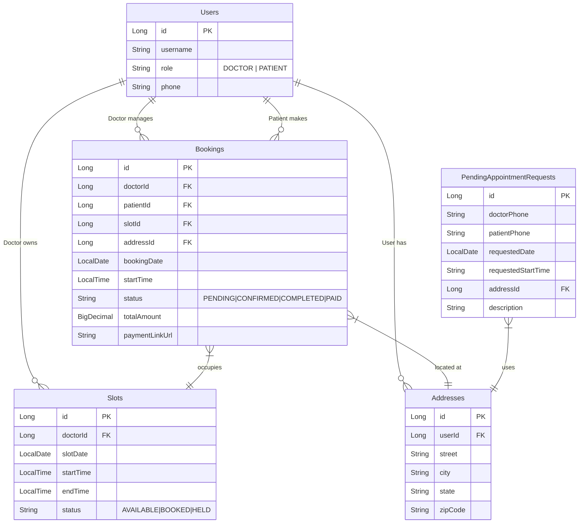
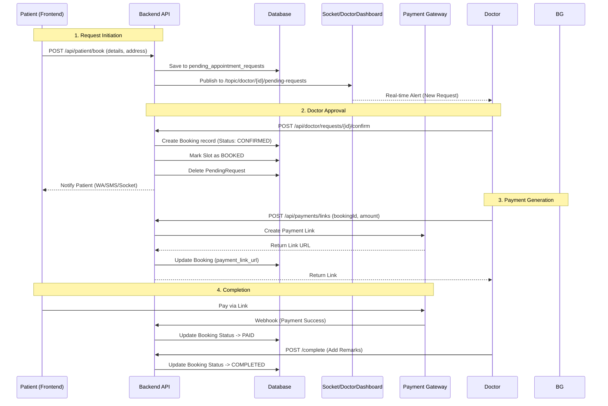

# Booking System Architecture

This document outlines the architecture, database design, and workflow for the Booking System in the WhatsApp Appointment & Billing System.

## 1. System Overview

The booking system handles the lifecycle of an appointment from the initial patient request to the final completion and payment. It supports:
-   **Patient-Initiated Bookings**: Patients request a specific time or slot.
-   **Doctor Approval**: Doctors review pending requests via a real-time dashboard.
-   **Slot Management**: Tracking availability of doctors.
-   **Payment Integration**: Generating payment links for confirmed bookings.

## 2. Database Design & Schema

The core of the booking system relies on the following tables and their relationships.

### Entity Relationship Diagram (ERD)

### Table Details

#### 1. `bookings`
The central record for a confirmed appointment.
-   **id**: Primary Key.
-   **doctor_id**: Foreign Key to `users` (Doctor).
-   **patient_id**: Foreign Key to `users` (Patient).
-   **slot_id**: Foreign Key to `slots` (Specific time slot occupied).
-   **address_id**: Foreign Key to `addresses` (Location/Patient Address).
-   **status**: Current state (`PENDING`, `CONFIRMED`, `COMPLETED`, `PAID`, `CANCELLED`).
-   **payment_link_url**: URL generated by Stripe/Razorpay.
-   **total_amount**: Cost of the consultation.
-   **doctor_notes**: Notes added by the doctor during/after the appointment.

#### 2. `pending_appointment_requests`
A temporary holding area for requests initiated by patients before doctor approval.
-   **doctor_phone**: Identifier for the target doctor.
-   **patient_phone**: Identifier for the requesting patient.
-   **requested_date**: Desired date.
-   **requested_start_time**: Desired time block.
-   **address_id**: Address selected by the patient.
-   **description**: Reason for visit/symptoms.

#### 3. `slots`
Manages the availability of doctors.
-   **doctor_id**: The doctor whom this slot belongs to.
-   **start/end_time**: Time range of availability.
-   **status**: `AVAILABLE` means it can be booked; `BOOKED` means it is taken.

## 3. Booking Workflow

### 3.1 Flow Diagram

### 3.2 Detailed Steps

1.  **Request Creation**:
    -   Patient selects a doctor, date, and time slot (or inputs a preferred time).
    -   Selects an address from their address book.
    -   Submits request.
    -   **Backend**: Saves data to `pending_appointment_requests`.

2.  **Notification & Approval**:
    -   The Doctor Dashboard listens to a WebSocket topic.
    -   The new request appears instantly in the "Pending Requests" queue.
    -   Doctor clicks "Confirm".
    -   **Backend**:
        -   Retrieves the pending request.
        -   Creates a formal `Booking` entity with status `CONFIRMED` (or `ACCEPTED`).
        -   Links the selected `Address` and `User` (Patient).
        -   Updates the `Slot` status to `BOOKED` to prevent double-booking.
        -   Deletes the `PendingAppointmentRequest`.

3.  **Payment Lifecycle**:
    -   Doctor clicks "Generate Payment Link" on the confirmed appointment.
    -   **Backend**: Calls Stripe/Razorpay API to create a payment link.
    -   The link is saved to the `Booking` record.
    -   When the patient pays, a Webhook triggers a status update on the `Booking` to `PAID`.

4.  **Appointment Completion**:
    -   After the visit, the doctor clicks "Complete".
    -   Enters remarks/diagnosis.
    -   **Backend**: Updates `Booking` status to `COMPLETED` and saves `doctor_notes`.

## 4. Key Relationships

-   **One-to-Many**: One `User` (Doctor) has many `Slots`.
-   **One-to-Many**: One `User` (Patient) has many `Addresses`.
-   **One-to-One / Many-to-One**: A `Booking` is linked to one specific `Slot` (if slot-based) and one specific `Address`.
-   **Transient**: `PendingAppointmentRequest` is a transient entity that transforms into a `Booking`.
